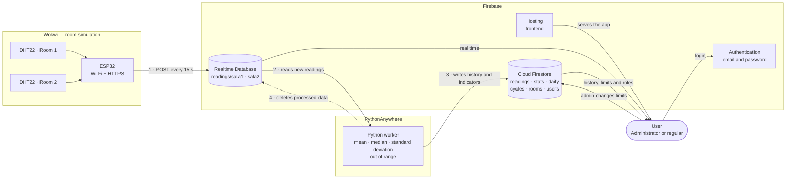

<div align="center">

# 🌡️ Hospital Room Monitor

**Real-time temperature and humidity monitoring for medical equipment storage rooms.**

[](https://firebase.google.com/)
[](https://vitejs.dev/)
[](https://www.chartjs.org/)
[](https://www.python.org/)
[](https://wokwi.com/)
[](LICENSE)

[**View demo →**](https://gabriel-santos-temp-wokwi.web.app)

</div>

<p align="center">
  
  <br>
  <sub>On the left, the sensors simulated in Wokwi (DHT22 at 26.7 °C); on the right, the dashboard already showing the reading and the above-maximum temperature alert.</sub>
</p>

---

## About

A system that continuously tracks the environmental conditions of **two hospital rooms** that store medical equipment. The sensors send their readings to Firebase; the system compares each value against the room's operating range, **raises visual alerts** when something goes out of bounds, and computes **mean, median and standard deviation** to support history analysis.

Project developed as a SENAI course assignment. The full assignment statement is in [`docs/ENUNCIADO.md`](docs/ENUNCIADO.md) (in Portuguese).

## Features

- 📡 **Real time:** per-room cards with temperature, humidity and status (Normal, Alert, No data), updated on every reading.
- 🚨 **Visual alerts:** fixed red banner at the top, highlighted card and a message stating which limit was violated.
- 📊 **Comparison charts:** temperature and humidity of both rooms on the same chart, with the limits drawn as dashed lines.
- 🧮 **Statistical indicators:** mean, median and standard deviation computed over the live window, the last processing cycle and the daily accumulation.
- 🕒 **History and analysis:** periods from 1 hour to 30 days, indicator table, trend (°C/h), out-of-range occurrences and daily accumulation, with automatically generated observations.
- 🔐 **Authentication and two access levels:**
  - **Administrator:** adjusts the minimum and maximum limits of each room and manages user roles.
  - **Regular user:** view-only.
  - Permissions are enforced in the **Firestore rules**, not just in the UI.
- 📱 **Responsive**, with automatic light/dark theme and a focus on accessibility.

## Services used

| Service | Role in the project |
|---|---|
| **[Wokwi](https://wokwi.com/)** | Simulates the **rooms and sensors**: one ESP32 with two DHT22 sensors (one per room). Temperature and humidity can be adjusted in the simulation to trigger alerts. |
| **Firebase Realtime Database** | Receives the sensor readings and delivers them to the dashboard with low latency (**real time**). Holds only data that has not been processed yet. |
| **Firebase Cloud Firestore** | **History and indicators** database: readings, per-cycle summaries, daily accumulation, room limits and user profiles. Enforces role-based permissions. |
| **Firebase Authentication** | **Email and password login**. The role (`admin` or `user`) is read from Firestore. |
| **Firebase Hosting** | **Publishes the frontend** (static web app) over HTTPS. |
| **[PythonAnywhere](https://www.pythonanywhere.com/)** | Hosts the **Python worker** that reads the Realtime Database, computes mean, median and standard deviation, and writes to Firestore. |

Also: **Vite** and **Chart.js** on the frontend, **Python** with `google-auth` in the worker, and **Arduino C++** on the ESP32.

## Architecture



**Flow:** the ESP32 (Wokwi) sends readings to the **Realtime Database**; the worker on **PythonAnywhere** fetches the new readings, computes the indicators, writes them to **Firestore** and cleans up what it has processed; the frontend, published on **Hosting**, shows real-time data straight from the Realtime Database and history from Firestore, after login through **Authentication**.

The **Realtime Database** provides low latency for the live dashboard. **Firestore** stores the history, queryable by period, and the settings, with role-based access rules. The Python process bridges the two, as the assignment requires.

| Collection / path | Contents |
|---|---|
| `readings/{room}` (RTDB) | Raw readings from the sensor, deleted after being processed |
| `rooms/{room}` | Name and temperature/humidity limits (editable by the admin) |
| `rooms/{room}/readings` | Raw history readings |
| `rooms/{room}/stats` | Summary of each cycle (mean, median, deviation, min., max., out of range) |
| `rooms/{room}/summary/latest` | Latest summary |
| `rooms/{room}/daily/{YYYY-MM-DD}` | Daily accumulation |
| `cycles/{id}` | Cycle mean for both rooms |
| `users/{uid}` | Email and role (`admin` or `user`) |

### The data in Firebase

<p align="center">
  
  <br>
  <sub><b>Realtime Database:</b> raw readings arrive at <code>readings/sala1</code> and <code>readings/sala2</code>, each with <code>temperature</code>, <code>humidity</code> and <code>timestamp</code> (filled in by the server). The worker deletes what has already been processed.</sub>
</p>

<p align="center">
  
  <br>
  <sub><b>Cloud Firestore:</b> <code>cycles</code> collection with the summary of each worker cycle (count, mean, minimum and maximum temperature and humidity, period start and end). Alongside it, <code>rooms</code> and <code>users</code>.</sub>
</p>

## Repository structure

```
.
├── frontend/          # Web app (Vite + JavaScript + Chart.js)
├── pythonanywhere/    # RTDB → Firestore processing (worker.py and flask_app.py)
├── wokwi/             # ESP32 simulation with the sensors
├── docs/              # Project plan, Firebase guide and assignment statement
├── firestore.rules    # Firestore security rules
├── database.rules.json# Realtime Database security rules
└── firebase.json      # Hosting and rules configuration
```

## How to run

### 1. Firebase

Create the project, enable **Authentication (email/password)**, **Firestore** and **Realtime Database**, and publish the rules. The step-by-step guide, with what each part of the system needs, is in [`docs/SETUP-FIREBASE.md`](docs/SETUP-FIREBASE.md).

```bash
npm i -g firebase-tools
firebase login
firebase use YOUR-PROJECT
firebase deploy --only firestore:rules,database
```

### 2. Sensors (Wokwi)

1. Create an ESP32 project at [wokwi.com](https://wokwi.com).
2. Copy `wokwi/sketch.ino`, `wokwi/diagram.json` and `wokwi/libraries.txt`.
3. Set `DB_URL` to your Realtime Database URL and run the simulation.

| Room | Sensor | Pin |
|---|---|---|
| sala1 | DHT22 | GPIO 15 |
| sala2 | DHT22 | GPIO 4 |

<p align="center">
  
  <br>
  <sub>Wokwi simulation: the serial monitor confirms the upload (<code>HTTP 200</code>) for each room.</sub>
</p>

### 3. Processing (Python)

Place the service account key (Firebase → *Project settings* → *Service accounts*) at `pythonanywhere/serviceAccountKey.json` and run the worker:

```bash
cd pythonanywhere
python3 -m venv .venv
.venv/bin/pip install -r requirements.txt
.venv/bin/python worker.py      # one cycle every 60 s
```

You can also expose `flask_app.py` and call `POST /run` from an external scheduler (see [`pythonanywhere/README.md`](pythonanywhere/README.md)).

### 4. Frontend

```bash
cd frontend
cp .env.example .env            # fill in with the Firebase web app config
npm install
npm run dev                     # development
npm run build                   # generates frontend/dist
```

To deploy: `firebase deploy --only hosting`.

**First administrator:** create an account through the site and change the `role` field of your document in `users` to `admin` in the Firestore console. From then on, roles are managed on the *Settings* screen.

## Screens

<p align="center">
  
  <br>
  <sub><b>Real time:</b> alert banner at the top, per-room cards with statistical indicators and a comparison chart with dashed limits.</sub>
</p>

<p align="center">
  
  <br>
  <sub><b>History:</b> temperature and humidity charts by period, with each room's limits.</sub>
</p>

<p align="center">
  
  <br>
  <sub><b>Analysis:</b> mean, median, standard deviation, trend, automatic observations and a list of out-of-range occurrences.</sub>
</p>

## Design decisions

- **Default ranges:** temperature 18–25 °C and humidity 30–60 %, editable per room by the administrator.
- **Sample standard deviation** (n − 1). In the long history, mean and deviation are exact (computed from the sum and the sum of squares of each cycle); the median is approximate and is marked with `*`.
- **Free quota:** with 2 rooms and one reading every 15 s, that is about 11.5 thousand writes per day to Firestore, below the free plan's limit of 20 thousand.
- **Idempotent processing:** documents have fixed IDs and the daily accumulation stores the last reading counted, so reprocessing a period after a failure does not duplicate data.

## Security

- Never commit `serviceAccountKey.json` or `.env` (both are already in `.gitignore`). The service account key has administrator access to the project.
- The Firebase web app keys (`apiKey`, etc.) are **not secrets**; protection comes from the security rules.
- The Realtime Database rules allow the simulator to write **without login**, only to `readings/sala1` and `readings/sala2` and with type and range validation. This is fine for the simulation; in production, the device should authenticate.
- New accounts are always created as `user`; only an administrator promotes other users.

## License

Distributed under the MIT license. See [`LICENSE`](LICENSE).
