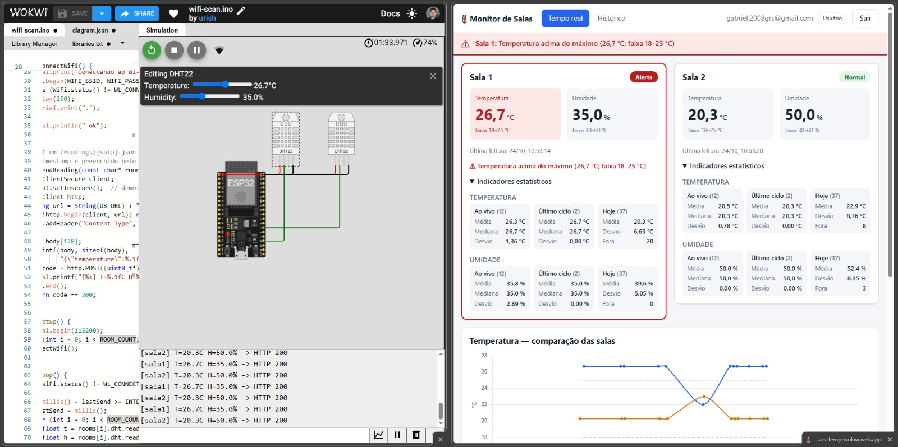
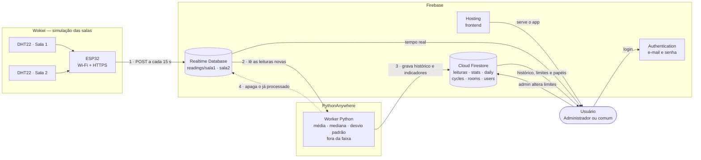
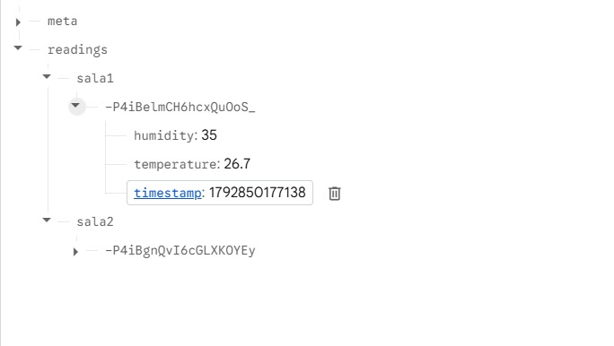
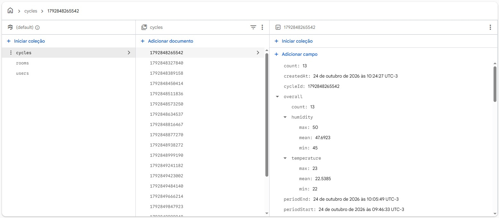
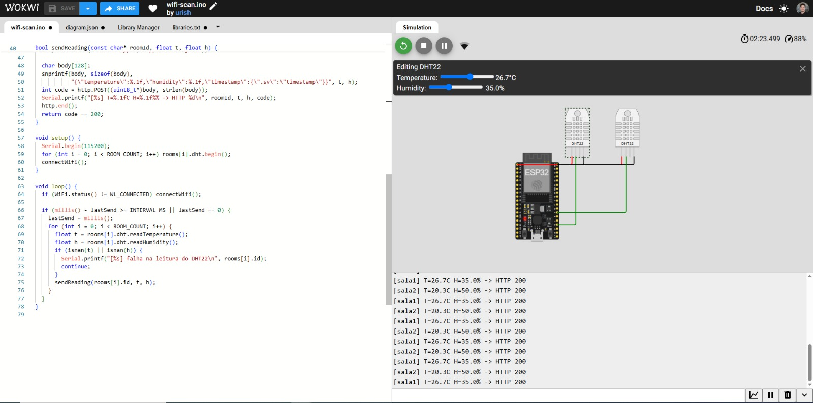
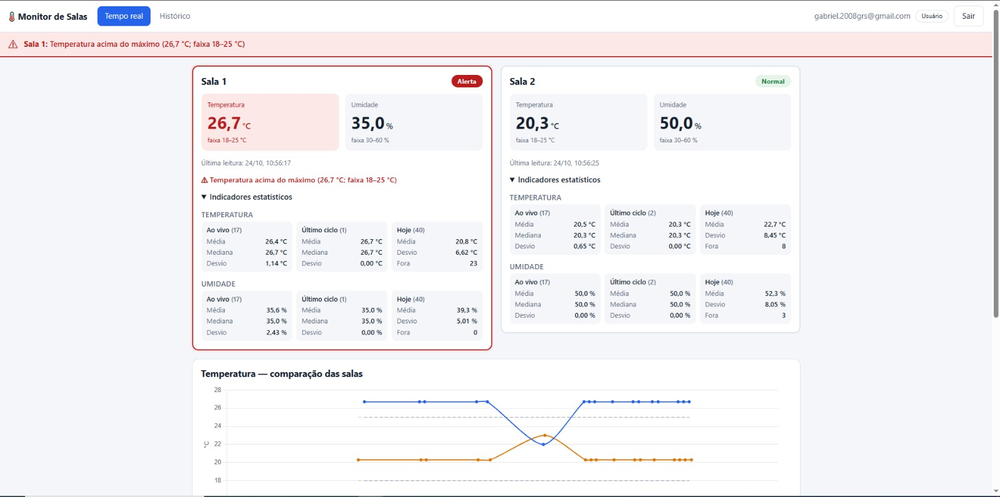
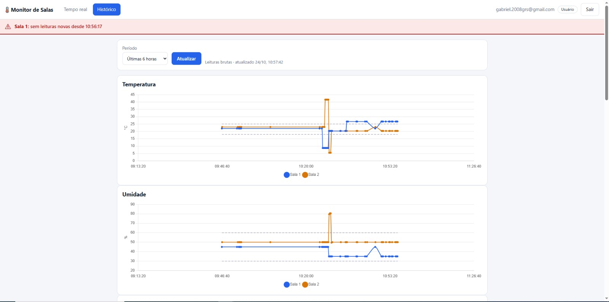
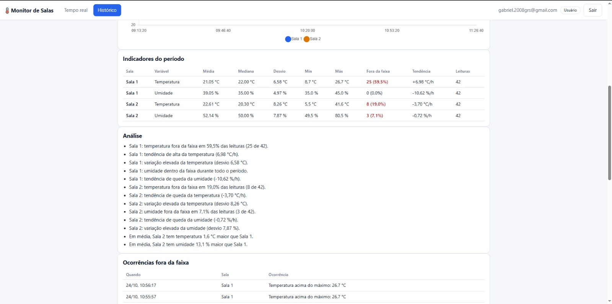

<div align="center">

# 🌡️ Monitor de Salas Hospitalares

**Monitoramento de temperatura e umidade em tempo real para salas de armazenamento de equipamentos médicos.**

[](https://firebase.google.com/)
[](https://vitejs.dev/)
[](https://www.chartjs.org/)
[](https://www.python.org/)
[](https://wokwi.com/)
[](LICENSE)

[**Ver demonstração →**](https://gabriel-santos-temp-wokwi.web.app)

</div>

<p align="center">
  
  <br>
  <sub>À esquerda, os sensores simulados no Wokwi (DHT22 a 26,7 °C); à direita, o painel já mostrando a leitura e o alerta de temperatura acima do máximo.</sub>
</p>

---

## Sobre

Sistema que acompanha continuamente as condições ambientais de **duas salas** de um hospital que guardam equipamentos médicos. Os sensores enviam as leituras para o Firebase; o sistema compara cada valor com a faixa de operação da sala, **emite alertas visuais** quando algo sai do limite e calcula **média, mediana e desvio padrão** para apoiar a análise do histórico.

Projeto desenvolvido como atividade do curso do SENAI. O enunciado completo está em [`docs/ENUNCIADO.md`](docs/ENUNCIADO.md).

## Funcionalidades

- 📡 **Tempo real:** cartões por sala com temperatura, umidade e status (Normal, Alerta, Sem dados), atualizados a cada leitura.
- 🚨 **Alertas visuais:** faixa vermelha fixa no topo, cartão destacado e mensagem indicando qual limite foi violado.
- 📊 **Gráficos comparativos:** temperatura e umidade das duas salas no mesmo gráfico, com os limites desenhados em linhas tracejadas.
- 🧮 **Indicadores estatísticos:** média, mediana e desvio padrão calculados sobre a janela ao vivo, o último ciclo de processamento e o acumulado do dia.
- 🕒 **Histórico e análise:** períodos de 1 hora a 30 dias, tabela de indicadores, tendência (°C/h), ocorrências fora da faixa e acumulado diário, com observações geradas automaticamente.
- 🔐 **Autenticação e dois níveis de acesso:**
  - **Administrador:** ajusta os limites mínimo e máximo de cada sala e gerencia os papéis dos usuários.
  - **Usuário comum:** apenas visualiza.
  - As permissões são aplicadas nas **regras do Firestore**, não só na interface.
- 📱 **Responsivo**, com tema claro/escuro automático e foco em acessibilidade.

## Serviços utilizados

| Serviço | Papel no projeto |
|---|---|
| **[Wokwi](https://wokwi.com/)** | Simula as **salas e os sensores**: um ESP32 com dois DHT22 (um por sala). Temperatura e umidade são ajustáveis na simulação para provocar alertas. |
| **Firebase Realtime Database** | Recebe as leituras dos sensores e as entrega ao painel com baixa latência (**tempo real**). Guarda só o que ainda não foi processado. |
| **Firebase Cloud Firestore** | Banco do **histórico e dos indicadores**: leituras, resumos por ciclo, acumulado diário, limites das salas e perfis de usuário. Aplica as permissões por papel. |
| **Firebase Authentication** | **Login com e-mail e senha**. O papel (`admin` ou `user`) é lido do Firestore. |
| **Firebase Hosting** | **Publica o frontend** (aplicação web estática) com HTTPS. |
| **[PythonAnywhere](https://www.pythonanywhere.com/)** | Hospeda o **worker em Python** que lê o Realtime Database, calcula média, mediana e desvio padrão e grava no Firestore. |

Além disso: **Vite** e **Chart.js** no frontend, **Python** com `google-auth` no worker e **Arduino C++** no ESP32.

## Arquitetura



**Fluxo:** o ESP32 (Wokwi) envia as leituras ao **Realtime Database**; o worker no **PythonAnywhere** busca as leituras novas, calcula os indicadores, grava no **Firestore** e limpa o que já processou; o frontend, publicado no **Hosting**, mostra o tempo real direto do Realtime Database e o histórico a partir do Firestore, depois do login no **Authentication**.

O **Realtime Database** entrega baixa latência para o painel ao vivo. O **Firestore** guarda o histórico consultável por período e as configurações, com regras de acesso por papel. O processo em Python faz a ponte entre os dois, conforme pede o enunciado.

| Coleção / caminho | Conteúdo |
|---|---|
| `readings/{sala}` (RTDB) | Leituras brutas vindas do sensor, apagadas depois de processadas |
| `rooms/{sala}` | Nome e limites de temperatura e umidade (editáveis pelo admin) |
| `rooms/{sala}/readings` | Leituras brutas do histórico |
| `rooms/{sala}/stats` | Resumo de cada ciclo (média, mediana, desvio, mín., máx., fora da faixa) |
| `rooms/{sala}/summary/latest` | Último resumo |
| `rooms/{sala}/daily/{AAAA-MM-DD}` | Acumulado do dia |
| `cycles/{id}` | Média do ciclo com as duas salas |
| `users/{uid}` | E-mail e papel (`admin` ou `user`) |

### Os dados no Firebase

<p align="center">
  
  <br>
  <sub><b>Realtime Database:</b> as leituras brutas chegam em <code>readings/sala1</code> e <code>readings/sala2</code>, cada uma com <code>temperature</code>, <code>humidity</code> e <code>timestamp</code> (preenchido pelo servidor). O worker apaga o que já foi processado.</sub>
</p>

<p align="center">
  
  <br>
  <sub><b>Cloud Firestore:</b> coleção <code>cycles</code> com o resumo de cada ciclo do worker (contagem, média, mínimo e máximo de temperatura e umidade, início e fim do período). Ao lado, <code>rooms</code> e <code>users</code>.</sub>
</p>

## Estrutura do repositório

```
.
├── frontend/          # Aplicação web (Vite + JavaScript + Chart.js)
├── pythonanywhere/    # Processamento RTDB → Firestore (worker.py e flask_app.py)
├── wokwi/             # Simulação do ESP32 com os sensores
├── docs/              # Plano do projeto, guia do Firebase e enunciado
├── firestore.rules    # Regras de segurança do Firestore
├── database.rules.json# Regras de segurança do Realtime Database
└── firebase.json      # Configuração do Hosting e das regras
```

## Como executar

### 1. Firebase

Crie o projeto, ative **Authentication (e-mail/senha)**, **Firestore** e **Realtime Database**, e publique as regras. O passo a passo, com o que cada parte do sistema precisa, está em [`docs/SETUP-FIREBASE.md`](docs/SETUP-FIREBASE.md).

```bash
npm i -g firebase-tools
firebase login
firebase use SEU-PROJETO
firebase deploy --only firestore:rules,database
```

### 2. Sensores (Wokwi)

1. Crie um projeto ESP32 em [wokwi.com](https://wokwi.com).
2. Copie `wokwi/sketch.ino`, `wokwi/diagram.json` e `wokwi/libraries.txt`.
3. Ajuste `DB_URL` para a URL do seu Realtime Database e rode a simulação.

| Sala | Sensor | Pino |
|---|---|---|
| sala1 | DHT22 | GPIO 15 |
| sala2 | DHT22 | GPIO 4 |

<p align="center">
  
  <br>
  <sub>Simulação no Wokwi: o monitor serial confirma o envio (<code>HTTP 200</code>) de cada sala.</sub>
</p>

### 3. Processamento (Python)

Coloque a chave da conta de serviço (Firebase → *Configurações do projeto* → *Contas de serviço*) em `pythonanywhere/serviceAccountKey.json` e rode o worker:

```bash
cd pythonanywhere
python3 -m venv .venv
.venv/bin/pip install -r requirements.txt
.venv/bin/python worker.py      # ciclo a cada 60 s
```

Também é possível expor o `flask_app.py` e chamar `POST /run` a partir de um agendador externo (veja [`pythonanywhere/README.md`](pythonanywhere/README.md)).

### 4. Frontend

```bash
cd frontend
cp .env.example .env            # preencha com a config do app web do Firebase
npm install
npm run dev                     # desenvolvimento
npm run build                   # gera frontend/dist
```

Para publicar: `firebase deploy --only hosting`.

**Primeiro administrador:** crie uma conta pelo site e altere o campo `role` do seu documento em `users` para `admin` no console do Firestore. Dali em diante, os papéis são gerenciados na tela *Configurações*.

## Telas

<p align="center">
  
  <br>
  <sub><b>Tempo real:</b> faixa de alerta no topo, cartões por sala com indicadores estatísticos e gráfico comparativo com os limites tracejados.</sub>
</p>

<p align="center">
  
  <br>
  <sub><b>Histórico:</b> gráficos de temperatura e umidade por período, com os limites de cada sala.</sub>
</p>

<p align="center">
  
  <br>
  <sub><b>Análise:</b> média, mediana, desvio padrão, tendência, observações automáticas e lista de ocorrências fora da faixa.</sub>
</p>

## Decisões de projeto

- **Faixas padrão:** temperatura 18–25 °C e umidade 30–60 %, editáveis por sala pelo administrador.
- **Desvio padrão amostral** (n − 1). No histórico longo, média e desvio são exatos (calculados a partir da soma e da soma dos quadrados de cada ciclo); a mediana é aproximada e aparece marcada com `*`.
- **Cota gratuita:** com 2 salas e uma leitura a cada 15 s são cerca de 11,5 mil escritas por dia no Firestore, abaixo do limite de 20 mil do plano gratuito.
- **Processamento idempotente:** os documentos têm IDs fixos e o acumulado diário guarda a última leitura contada, então reprocessar um período após uma falha não duplica dados.

## Segurança

- Nunca versione o `serviceAccountKey.json` nem o `.env` (já estão no `.gitignore`). A chave da conta de serviço tem acesso de administrador ao projeto.
- As chaves do app web do Firebase (`apiKey`, etc.) **não são segredos**; a proteção vem das regras de segurança.
- As regras do Realtime Database permitem que o simulador grave **sem login**, apenas em `readings/sala1` e `readings/sala2` e com validação de tipo e faixa. Isso é adequado para a simulação; em produção, o dispositivo deveria se autenticar.
- Contas novas sempre nascem como `user`; só um administrador promove outros usuários.

## Licença

Distribuído sob a licença MIT. Veja [`LICENSE`](LICENSE).
